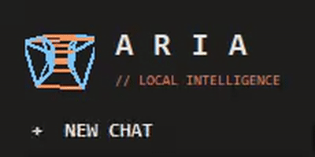
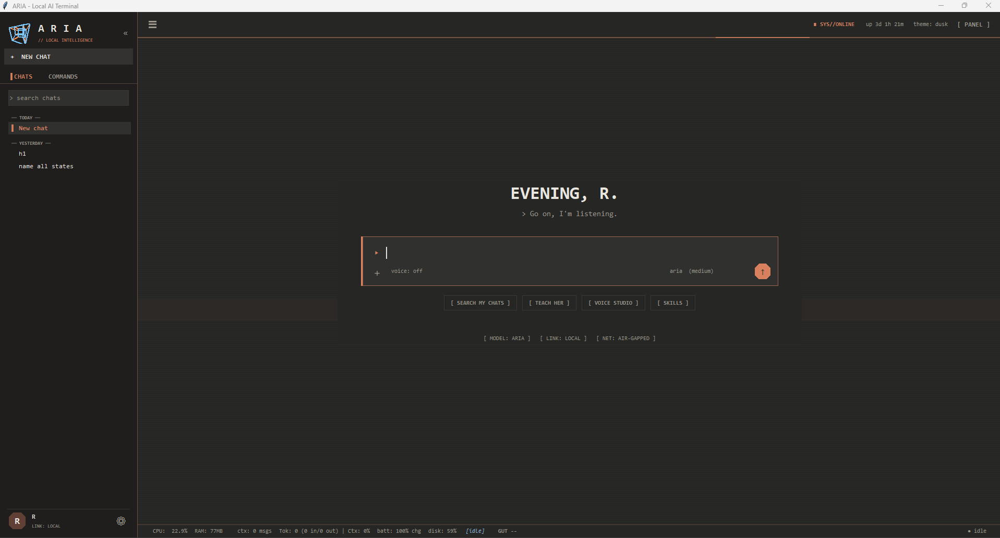
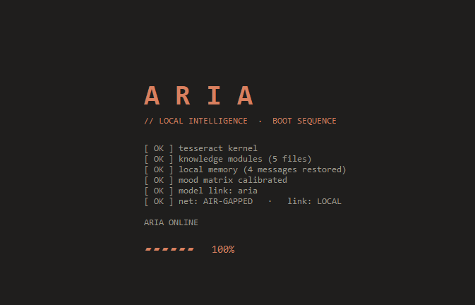

<p align="center">
  
</p>

# ARIA: Adaptive Reasoning Intelligence Assistant

ARIA is a fully offline personal AI assistant that I designed and built from scratch. It is a terminal-style desktop app (Python, tkinter) that runs a local language model on my own PC. There are no cloud APIs and no internet requirement once it is set up, so my chats, memory and files stay on my machine.

She is more than a chat window. She can take actions on the computer (with my approval), remember things between sessions, speak and listen, learn from my feedback, and measure her own performance. Around the main app sits a set of experiments: reinforcement-learning game agents, a neural-network-from-scratch learning project, and a simulation of a real fruit-fly brain wiring diagram.

> **The source code is private.** This repository is a showcase of what ARIA is, what she does, and how she is put together. I'm happy to walk through the code or give a live demo on request.





---

## Contents

- [What ARIA is](#what-aria-is)
- [What she can do](#what-she-can-do)
- [How she answers a message](#how-she-answers-a-message)
- [How she is built](#how-she-is-built)
- [Project structure](#project-structure)
- [Experiments and side modules](#experiments-and-side-modules)
- [Design principles](#design-principles)
- [Tech](#tech)
- [Related public projects](#related-public-projects)

---

## What ARIA is

| | |
|---|---|
| **Type** | Local, offline AI assistant with a desktop UI |
| **Language / UI** | Python 3, tkinter |
| **Model runtime** | [Ollama](https://ollama.com) as the primary backend, with a built-in llama.cpp backend (GGUF models) as a local fallback |
| **Model** | A custom `aria` model built locally on top of an open base model (Qwen3.5), shaped by my own small dialogue dataset to *answer from what it is given, not invent, and ask when something is missing* |
| **Platforms** | Windows first, with a macOS/Linux launcher |
| **Data** | Everything lives in one portable folder: copy it to another machine and it runs from wherever it lands |

---

## What she can do

### Chat and answer locally
- Streams replies from a local model with live model switching and selectable personas.
- Adjustable personality: temperature, warmth, verbosity, humor and how much she volunteers suggestions.
- Context compression keeps long conversations inside the model's window, and a response cache avoids repeating work.

### Take actions on the PC, with approval
- A tool-calling system lets her list, read, write, edit, move and rename files, run terminal commands and Python scripts, make folders, and run git commands.
- She can scaffold and track projects: create a project, add tasks, list them, and tick them off.
- **Every action asks for a yes/no approval first**, showing a preview (for example a diff of an edit), and her file and terminal tools are confined to a single projects folder.
- Tool calls are validated before they run: fuzzy repair of mistyped tool names, a three-strike limit, and stall detection. Large tool outputs are spilled to disk instead of flooding the prompt, and secrets are redacted before anything is logged.
- Optional extras: browser control, scheduled (cron-style) tasks, and image analysis tools.

### Remember things
- **Durable facts** and **semantic memory** she can save and forget on request.
- **A knowledge base** of my own notes and documents, searched by meaning using embeddings, with only the best few snippets added to each prompt.
- **Saved chats**, plus a full-text archive of everything ever said to her, so she can find "that thing we figured out three weeks ago".
- **Memory loop**: a newer memory engine with a privacy filter, a durable-fact check, rule-based and model-based extraction, a Markdown disk store, and BM25 retrieval with alias handling.
- A crash-recovery write-ahead log protects the current session.

### Learn from me
- **Feedback learning:** typed feedback and good/bad ratings are stored with her replies. Corrections can be distilled into short standing rules that are applied to later answers.
- **Self-written skills:** after a multi-step task goes well, she can save how she did it as a small Markdown skill. When a later message looks similar, those steps are added to her prompt. Feedback is recorded on each skill, bad notes become "pitfalls", and she can rewrite a skill using them.
- **Adaptive brain:** two small PyTorch networks turn typed feedback into adjustments of her behavior settings. It has its own "Workshop" panel where I can watch it train, retrain on the feedback log, or roll back a bad run.

### Talk and listen offline
- Text-to-speech with a voice-effect chain that turns a plain system voice into other voices (pitch, vocal-tract size, vibrato, breath and more).
- **Voice Studio:** a tool for building and tuning voices while watching the waveform, spectrogram and pitch live, with saved named voices.
- Speech-to-text with Vosk. The microphone is ignored while she speaks, so she never answers herself.

### Measure herself and stay debuggable
- Every reply ends with a speed line: first-token time, prompt size, tokens per second, and whether the model ran on GPU, CPU or both.
- A `perf` command and a Performance tab summarize this over time. `doctor` checks models, GPU and optional integrations and says what to fix, in order.
- Separate logs for performance, errors that used to be silently swallowed, and every action taken on the PC.

### The interface
- A themed terminal-style window with idle chatter, moods, a stats bar and a spinning tesseract.
- A sidebar command center with every command as a searchable button, a `Ctrl+K` command palette, one-click rating, and side panels for learning, skills and past-chat search.
- A system monitor and a downloads-folder watchdog.

### Connect to other tools (optional)
- A bridge that hands heavy multi-step jobs to the Hermes agent and brings the answer back, plus a shared group-chat mode.
- A Discord bridge.

---

## How she answers a message

```
 you type a message
        │
        ▼
 ┌──────────────────────┐   match   ┌────────────────────────────┐
 │ 1. Instant skills    │ ────────▶ │ answer immediately,        │
 │ time, math, timers,  │           │ no model call              │
 │ help                 │           └────────────────────────────┘
 └──────────┬───────────┘
            │ no match
            ▼
 ┌──────────────────────┐
 │ 2. Tool-need check   │  a trained classifier (plus a fast
 │ chat or action?      │  "gut feeling" circuit, see below)
 └──────────┬───────────┘
      chat  │         action
   ┌────────┘         └─────────┐
   ▼                            ▼
 compact prompt        full prompt + tool definitions
   │                            │
   └──────────────┬─────────────┘
                  ▼
 ┌──────────────────────────────────────┐
 │ 3. Add context                       │
 │ facts, memory, knowledge snippets,   │
 │ matching skills, learned rules       │
 └──────────────────┬───────────────────┘
                    ▼
 ┌──────────────────────────────────────┐
 │ 4. Local model streams the reply     │
 │ (Ollama, or llama.cpp as fallback)   │
 └──────────────────┬───────────────────┘
                    ▼
        action requested? ─▶ show preview ─▶ ask y/n ─▶ run ─▶ log
```

Short messages and greetings never use tools, and a per-message cap on added context keeps prompts small so replies stay fast even on modest hardware.

---

## How she is built

| Area | What it does |
|---|---|
| **Application core** | Small, focused Python modules: configuration, prompts, tools, memory, knowledge search, facts, chats, routing, performance tracking |
| **Terminal UI** | A tkinter window split by job: chat flow, streaming, model transport, prompt building, typed commands, panels, theming, voice |
| **Model transport** | One layer that talks to Ollama and falls back to a local llama.cpp runner, so ARIA still works if Ollama isn't running |
| **Router** | Rule-based instant skills first, then a trained classifier that decides when tools are needed |
| **Memory** | SQLite-backed semantic memory with cached search, durable facts, a Markdown memory store with BM25 retrieval, and an embedding-searched knowledge base |
| **Learning** | Feedback store, distilled rules, self-written skills, and the PyTorch adaptive brain |
| **Voice** | Offline speech-to-text, text-to-speech, a voice effect chain and Voice Studio |
| **Safety and reliability** | Approval for every action, a confined working folder, tool-call validation, secret redaction, crash-recovery log, one-click launchers that build a virtual environment, and a self-check script |

### The "gut feeling" circuit

One of the more unusual pieces is a small rate-coded circuit modelled on the **mushroom body** of the fruit fly, the insect's learning center, and wired from real connectome data (hundreds of projection neurons feeding thousands of Kenyon cells). A message is turned into word features, passed through the circuit, and the result serves as a fast instinct about the message that can feed her routing decisions. It answers in milliseconds because it is rate-coded rather than spiking.

---

## Project structure

The source is private, but this is how the project is laid out. Everything sits in one portable folder.

```
ARIA/
├── appV12.2.2 Watch.py        tiny launcher that run.bat / run.sh start
├── run.bat / run.sh           create the virtual environment, install dependencies, start ARIA
├── verify_setup.py            self-check for the whole folder (add --deep for functional checks)
├── aria_config.json           settings: model, history length, voice style, prompt budget, ...
├── Modelfile                  recipe for the local GGUF model
├── CHANGELOG.md
├── requirements.txt
│
├── aria_app/                  THE APPLICATION
│   ├── config.py              settings, paths, model lock, timeouts
│   ├── prompts.py             system prompts and accuracy rules
│   ├── tools.py               file, terminal, project and game tools
│   ├── tools_*.py             browser, scheduling, vision and image tools
│   ├── tool_validator.py      name repair, 3-strike limit, stall detection
│   ├── router.py, brain.py    instant skills, learned tool router, adaptive brain hook
│   ├── memory.py, semantic.py, knowledge.py, facts.py, chats.py, embeddings.py, sessions.py
│   ├── learning.py, skills.py feedback store, rules, self-written skills
│   ├── mushroom.py            fruit-fly mushroom-body "gut feeling" circuit
│   ├── context_compressor.py, runtime.py, prompt_cache.py, wal.py, perf.py
│   ├── voice.py, voicefx.py, voicebank.py, voicestudio.py
│   ├── secret_redactor.py, sanitize.py, vault.py
│   ├── memloop/               upgraded memory engine (filter, extract, store, retrieve, evaluate)
│   ├── training/              dataset curation and hallucination / prompt-injection checks
│   ├── utils/                 tool-output spillover to disk
│   └── terminal/              the window, split by job
│       ├── app.py, layout.py, modern.py, visuals.py, panel.py, mindpanel.py, commandcenter.py
│       ├── chat.py, streaming.py, transport.py, prompting.py, commands.py, recall.py
│       ├── voice.py, monitor.py, doctor.py, skills.py, learning.py, history.py
│       └── hermes.py, groupchat.py, discord.py     optional bridges
│
├── modules/                   STANDALONE MODULES (mostly not imported by the app yet)
│   ├── adaptive_brain/        feedback to personality knobs, with a Workshop panel
│   ├── aria_lm/               dataset tools, `aria` model builder, validation scorer, LoRA fine-tune script
│   ├── llama_cpp_backend/     local llama.cpp runner (also used as the app's fallback backend)
│   ├── vector_memory/         vector-database memory upgrade + migration script
│   ├── approval_memory/       review queue for candidate memories
│   ├── pdf_knowledge/         PDF to per-page Markdown for the knowledge base
│   ├── splice_bits/           scan a project for TODOs and decisions, redacting secrets
│   ├── voice_io/, voice_io_whisper/     Vosk and Whisper + Coqui speech tools
│   ├── game_capture/, game_reader/      screenshot capture, labelling, YOLO detection
│   ├── unified_game_ai/       reusable Double-DQN trainer
│   └── spectator_dashboard/   live browser view of a game agent
│
├── ARIA Projects/             the ONLY place her file and terminal tools may write
│   ├── Game-Testing/          Snake agents (RL) and checkpoints
│   ├── Learning/              tool-router training data and models
│   └── ...                    projects ARIA scaffolds for me
│
├── foundations/               from-scratch ML learning project (perceptron to optimizers)
├── NNET/                      connectome-style neural network experiments
├── labs/flybrain/             fruit-fly brain simulator
├── aria_skills/               Markdown skills she has written for herself
├── aria_knowledge/            my notes and documents that she can search
├── memory/                    durable memory files
├── docs/                      history and benchmark notes
├── models/, runtime/          local model files and llama.cpp binaries (not in version control)
└── aria_*.log                 performance, error and action logs
```

Personal data (chats, memory databases, logs, model files) is deliberately kept out of version control.

---

## Experiments and side modules

Alongside the main app I built standalone modules to explore and extend her. They are kept separate so each can be tried on its own and merged later.

### Game-playing agents
- A reinforcement-learning **Snake** agent trained with a curriculum and versioned checkpoints, with a graphical front end and a watch mode.
- A reusable **Double-DQN** trainer with a per-step hook, and a **spectator dashboard** that shows in the browser what an agent sees and does.
- A **screen-capture and OCR pipeline**: capture game screenshots by hotkey or change detection, pre-label them for YOLO, convert screenshots to structured JSON, and train a detector.

### Neuroscience-inspired networks
- **Fruit-fly brain lab:** loads a published male fruit-fly central nervous system connectome (about 176,000 neurons and 6.3 million connections) and simulates it with leaky integrate-and-fire neurons. I can stimulate chosen neurons and watch others, for example sugar taste driving the proboscis motor neuron, or looming vision triggering the escape-jump giant fibre.
- **Connectome-style neural nets (`NNET/`):** sparse, continuous-time leaky-integrator networks with layered and columnar topologies, checkpointing, visualization and a CLI. Experiments include a sparse recurrent alternative to ARIA's tool classifier and a recurrent core for the Snake DQN.

### Voice
- A Whisper-based speech-to-text app and a drop-in Whisper + Coqui upgrade for her voice.

### Memory and knowledge tools
- A vector-database memory upgrade with a migration script.
- A review queue that proposes candidate memories from raw conversation and only saves the ones I approve.
- PDF-to-Markdown conversion for her knowledge base, and a scanner that surfaces TODOs and decisions while redacting secrets.

### Model building
- Dataset validation, merging and splitting, a builder for the custom `aria` Ollama model, a held-out validation scorer to compare models, and a GPU LoRA fine-tune script.

### From-scratch ML (`foundations/`)
A learning project that builds, with no ML libraries, a perceptron (including its famous failure on XOR), a two-layer network with hand-written backpropagation, a character-level language model that saves and resumes training, and several optimizers (SGD with momentum, AdamW, LARS).

---

## Design principles

- **Offline first.** Nothing leaves the machine.
- **Approval before action.** She proposes, I confirm, and everything she does is logged.
- **Grounded answers.** Her model is tuned and prompted to answer from what she is given, not to invent, and to ask when information is missing.
- **Measure, don't guess.** Speed, errors and actions are all recorded so problems can be diagnosed from data.
- **Small modules.** The app is split into small, focused files, and experiments stay standalone until they earn a place in the main app.
- **Portable.** One folder, one launcher, one self-check.

---

## Tech

Python, tkinter, Ollama and local LLMs, llama.cpp (GGUF), PyTorch, NumPy, Vosk, Whisper, pyttsx3, SQLite (including full-text search), embedding-based retrieval, BM25, reinforcement learning (DQN), YOLO and OCR.

---

## Related public projects

- [speech-to-text](https://github.com/boehub/speech-to-text): a fully local Whisper-based speech-to-text app
