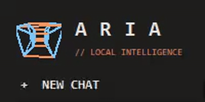
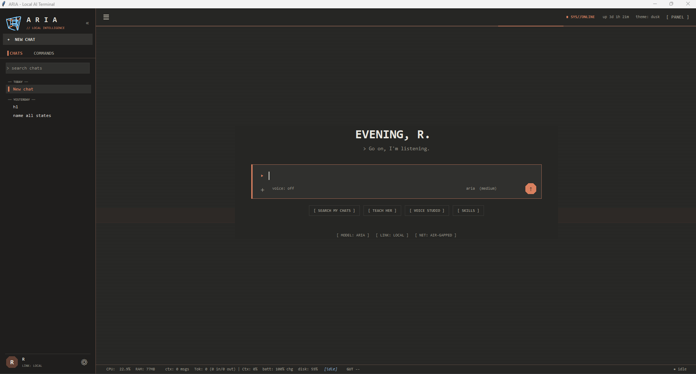
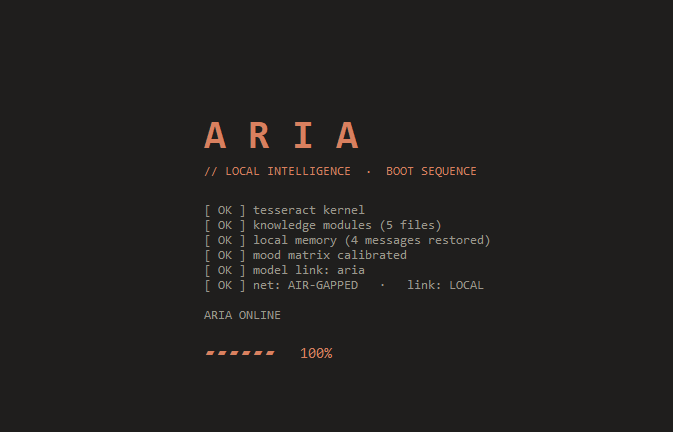

  

# ARIA: Offline Personal AI Assistant

A fully offline personal AI assistant I designed and built from scratch: a terminal-style desktop app (Python, tkinter) that talks to a local language model through Ollama. No cloud APIs and no internet needed once it is set up, so my data stays on my own machine.

> **Source code is private.** This repository is a showcase of what ARIA does and how she is built. I'm happy to walk through the code or demo her live on request.

## What she can do

- **Chat and answer locally.** Streams replies from a local model (a custom `aria` model built on top of an open base model), with live model switching and adjustable personality.
- **Take actions on the PC, with approval.** She can work with files, run terminal commands, and scaffold projects through a tool-calling system, and every action asks for a yes/no approval first. Her file and terminal tools are limited to one project folder.
- **Remember things.** Semantic memory, durable facts, saved chats and a searchable knowledge base (embedding-based retrieval) are added to her prompt when relevant.
- **Talk and listen offline.** Text-to-speech with a selectable voice style, and speech-to-text with Vosk. The microphone is ignored while she speaks so she doesn't answer herself.
- **Learn from feedback.** An adaptive "brain" module tunes her personality settings (temperature, verbosity, warmth and more) from typed feedback, using a small reinforcement-learning model in PyTorch.
- **Measure herself.** A `perf` command and a Performance tab show first-token time, prompt size, tokens per second, and whether the model is running on GPU or CPU, so slow replies can be diagnosed.

## How she answers a message

1. Rule-based skills (time, math, timers, help) answer instantly, with no model call.
2. A learned tool-need classifier decides whether the message is chat or an action request. Short messages and greetings never use tools.
3. Chat uses a compact prompt. Action requests use the full prompt plus tool definitions, and every action needs approval.
4. Relevant memory and knowledge snippets are added, then the model streams its reply.

## Architecture

| Area | What it does |
|---|---|
| Application core | Small, focused Python modules: configuration, prompts, tools, memory, knowledge search, facts, chats, routing, performance tracking |
| Terminal UI | A tkinter window split by job: chat flow, streaming, model transport, prompt building, typed commands, side panels |
| Memory | SQLite-backed semantic memory with cached search, plus a knowledge base searched by embeddings |
| Router | A trained intent classifier that loads at startup to decide when tools are needed |
| Voice | Offline speech-to-text (Vosk) and text-to-speech with voice effects |
| Reliability | One-click launchers that build a virtual environment, a setup self-check script, and logs for performance, errors and actions taken |

## Experiments and side modules

Alongside the main app I built standalone modules to explore and extend her:

- **Game-playing agents:** a reinforcement-learning Snake agent trained with a curriculum and versioned checkpoints; a reusable Double-DQN trainer; a screen-capture and OCR pipeline for game agents
- **Voice:** a Whisper-based speech-to-text app and a drop-in Whisper + Coqui upgrade for her voice
- **Memory upgrades:** a vector-database memory with a migration script
- **Knowledge tools:** PDF-to-markdown conversion for her knowledge base, and a scanner that surfaces TODOs and decisions while redacting secrets
- **Alternate backend:** a llama.cpp backend for models Ollama doesn't package
- **From-scratch ML:** a learning project that builds a perceptron, a neural network with hand-written backpropagation, a character-level language model and several optimizers (SGD with momentum, AdamW, LARS) without ML libraries

## Tech

Python, tkinter, Ollama and local LLMs, PyTorch, Vosk, pyttsx3, SQLite, embedding-based retrieval, reinforcement learning (DQN), OCR.

## Related public projects

- [speech-to-text](https://github.com/boehub/speech-to-text): a fully local Whisper-based speech-to-text app
- [data-skimmer](https://github.com/boehub/data-skimmer): drag-and-drop text extraction and question answering with a local LLM
